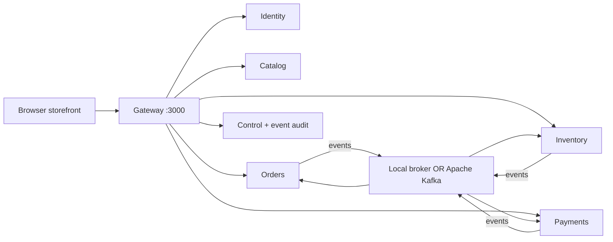

# Backend engineering guide

## Runtime and service boundaries

The backend is ESM JavaScript on Node 24 using `node:http`, `node:sqlite`, `node:crypto`, native fetch and filesystem APIs. No transpilation or web framework is required. Kafka mode additionally loads KafkaJS 2.2.4. These are real independently running services with HTTP and event boundaries; they share source utilities, not live application memory or business databases.

| Process | Port | Owned data | External API |
|---|---:|---|---|
| Gateway | 3000 | In-memory rate counters | Static UI, proxy, QA façade, specification |
| Broker/control | 4100 | Event mirror, QA settings | Internal `/events`, `/recent`, `/config` |
| Identity | 4101 | Users and sessions | `/api/auth/*` |
| Catalog | 4102 | Seeded product records | `/api/products*` |
| Orders | 4103 | Carts, orders, idempotency, outbox/inbox/cursor | `/api/cart`, `/api/orders*` |
| Inventory | 4104 | Available stock, reservations, outbox/inbox/cursor | `/api/inventory` |
| Payments | 4105 | Simulated payment records, outbox/inbox/cursor | `/api/payments/{orderId}` |

By default all listeners bind to `127.0.0.1`. Use the gateway to exercise the complete application: direct service calls bypass latency, browser-origin checks and gateway rate limiting. Container listeners bind inside their private Docker network; only gateway and Kafka's host development listener are published on loopback.



Orders synchronously reads catalog prices at checkout and asks Identity to validate bearer tokens. Payments verifies ownership through Orders before returning a payment. This deliberately offers both REST dependency testing and asynchronous event testing.

## Source map

- `services/common.mjs`: port/URL configuration, SQLite wrapper, JSON/error helpers, seeded catalog and scenario defaults.
- `services/launch.mjs`: starts the seven local processes, shuts children down on terminal signals, fails the run when a child exits with an error.
- `services/gateway.mjs`: safe static-file allowlist, service proxy, scenario façade, response policy, fault injection.
- `services/service.mjs`: service-specific HTTP route branches, authentication, checkout transaction and event-driven domain handlers. `SERVICE` selects the process role.
- `services/events.mjs`: durable outbox delivery, local polling or Kafka subscription, inbox deduplication.
- `services/broker.mjs`: persistent local event log, Kafka audit mirror and global scenario configuration.
- `services/spec.mjs`: generates the committed OpenAPI contract. Run `npm run spec` after changing the API.
- `services/reset.mjs`: refuses an active lab, then preserves the old data directory as a timestamped backup.

For a larger project, split `service.mjs` into service folders while preserving these process/data boundaries. Shared schemas and contract tests would be the next step; the compact structure here makes a training environment easy to inspect.

## Data ownership and transactions

Each process opens its own `{service}.sqlite` file under `DATA_DIR` (default `data/`). SQLite runs in WAL mode with a 5-second busy timeout. Most records are JSON snapshots in a `state(key,value)` table. The broker additionally has an append-only `events(seq,id,payload)` table with a unique event ID.

`store.transaction` uses `BEGIN IMMEDIATE`, commit and rollback. No asynchronous work is permitted inside its callback. Inventory's stock check and decrement happen in one transaction, preventing overselling. Checkout saves the order, idempotency record, cart clear and outbox entry in one transaction after its asynchronous catalog lookups. It rechecks both idempotency and cart contents inside that transaction.

This layout favors inspectability over query efficiency. JSON snapshots, unbounded inbox records, an unbounded audit log and synchronous SQLite access are intentional small-lab tradeoffs, not a recommendation for high-volume production. There is no cross-service SQL or shared transaction.

## Event envelope and contracts

```json
{
  "id": "event-uuid",
  "type": "OrderPlaced",
  "orderId": "order-uuid",
  "data": {
    "items": [{"productId":"p1","quantity":1,"name":"Arc Wireless Headphones","unitPrice":12900}],
    "total": 13600,
    "paymentMethod": "test-card"
  },
  "createdAt": "2026-10-28T18:00:00.000Z"
}
```

| Event | Producer | Handling services | Data |
|---|---|---|---|
| `OrderPlaced` | Orders | Inventory | items, total, paymentMethod |
| `InventoryReserved` | Inventory | Orders, Payments | total, paymentMethod |
| `InventoryRejected` | Inventory | Orders | reason |
| `PaymentApproved` | Payments | Orders | amount, reason (`approve`) |
| `PaymentFailed` | Payments | Orders, Inventory | amount, reason (`decline` or `timeout`) |
| `InventoryReleased` | Inventory | Orders | reason |
| `OrderConfirmed` | Orders | Audit only | total |

`seq` is an audit-log sequence assigned by the local broker, not a Kafka offset. It can differ from Kafka append order because the audit mirror is written after publication. No shipping address, password or token is published in event payloads.

## Delivery reliability

1. Domain handlers append an event to their service-owned outbox in the same SQLite transaction as the state mutation.
2. A worker runs roughly every 200 ms and publishes pending events. Network calls happen outside the local transaction.
3. After successful publication and audit mirroring, that event ID is removed from the outbox. A crash in between may cause redelivery.
4. Each consuming service stores an inbox keyed by event ID, in the same transaction as its domain changes and newly emitted events.
5. Inventory also guards reservations by order ID; Payments records one payment per order; Orders only permits valid forward state transitions.

These provide **at-least-once transport with idempotent domain effects**, not distributed exactly-once transactions. A retried publication may exist more than once in Kafka. Kafka offsets are committed only after local handling succeeds. A crash after inbox commit but before offset commit is safe to redeliver.

Default local mode reads an ordered SQLite-backed HTTP event log in batches of 500 and saves each service's cursor only after handling. Duplicate scenario mode appends a second audit record with `originalId`; local consumers normalize to that ID for deduplication. Kafka duplicate mode publishes the same event ID twice. The mirror's unique event IDs hide literal same-ID Kafka duplicates, so inspect Kafka directly to observe those duplicates on the wire.

There is no dead-letter queue or poison-message quarantine. A failed handler stops cursor progress and is retried; `/health` reports a degraded event worker after an interval failure. This is useful for outage exercises, but one poison event can block a consumer. Unknown event types are consumed as no-ops. Do not manually inject malformed events unless you are intentionally investigating a broken stream.

## Kafka mode

`EVENT_TRANSPORT=kafka` selects KafkaJS. Services create `commerce.events` if absent (one partition, replication factor one). All producers use `orderId` as message key. Each consuming service has its own group: `qa-commerce-orders`, `qa-commerce-inventory`, `qa-commerce-payments`. Consumers read from the beginning for a new group; otherwise committed offsets resume.

Compose pins Apache Kafka `4.2.2`, runs a single combined broker/controller in KRaft mode, persists its log in a named volume and starts application containers after broker health succeeds. No ZooKeeper is needed. This topology tests messaging and service failure; it does not test multi-broker replication or leader failover. The app audit/control process still runs in Kafka mode for scenario configuration and event visibility.

Useful commands after `docker compose up --build -d`:

```powershell
# Read the stream
docker compose exec kafka /opt/kafka/bin/kafka-console-consumer.sh --bootstrap-server kafka:9092 --topic commerce.events --from-beginning
# Inspect offsets and consumer lag
docker compose exec kafka /opt/kafka/bin/kafka-consumer-groups.sh --bootstrap-server kafka:9092 --describe --all-groups
# Stop/restart only the inventory service
docker compose stop inventory
docker compose start inventory
```

Do not run a second lab against the same Kafka topic/groups with unrelated databases: messages could be consumed by the wrong lab instance. Reset service databases and Kafka together for a fresh timeline. Migrating an existing local event timeline to Kafka is not automated.

## Scenario settings

| Setting | Default | Effect |
|---|---|---|
| locatorMode | stable | `dynamic` changes rendered card classes/button IDs and omits test IDs |
| renderDelay | 0 | Browser waits 0–5000 ms before rendering product results |
| apiDelay | 0 | Gateway waits 0–5000 ms before business API requests |
| paymentMode | approve | `approve`, `decline`, or deterministic `timeout` failure |
| paymentDelay | 0 | Payments waits 0–5000 ms for a reservation event |
| pauseInventory | false | Stop Inventory consumer progress, including compensation |
| pausePayments | false | Stop Payments consumer progress |
| duplicateEvents | false | Publish duplicate event deliveries |
| stalePrice | false | List prices $1 below authoritative detail prices |
| rateLimit | false | 12 business requests per 10-second window per token/IP |
| sessionSeconds | 3600 | Lifetime of newly created tokens, range 1–86400 |

Settings are global, stored in broker SQLite, and persist across restart. QA routes bypass latency/rate limiting so you can recover the lab. Pausing a consumer blocks all its event progress, not just selected orders. A payment delay is read once when the reservation begins processing; changing it midway does not cancel the current wait. There is no seeded randomness: given fixed inputs and settings, business outcomes are deterministic. IDs and timestamps still vary.

## HTTP and security behavior

JSON errors use `{ "error": "message" }`. Invalid JSON or non-object bodies return 400; bodies over 100,000 buffered characters return 413. Domain validation generally returns 422; conflicts 409; expired or absent credentials 401; nonexistent or other-user orders 404; scenario limits 429 with `Retry-After`; unavailable dependencies generally appear as 503 through the gateway or 500 inside a service.

Identity uses random opaque 32-byte tokens and salted scrypt hashes. Token expiry is checked server-side. Protected services validate tokens through Identity. Sessions persist on disk. HTTPS, OAuth, CSRF tokens, distributed throttling and production hardening are not implemented. The gateway rejects unexpected Host headers and cross-origin browser requests, uses a restrictive content policy and only serves allowlisted files. These support localhost use; internal APIs and unauthenticated QA controls remain trusted local surfaces.

## Environment variables

| Variable | Purpose |
|---|---|
| `SERVICE` | identity, catalog, orders, inventory, payments (or gateway/broker for health configuration) |
| `PORT_OFFSET` | Add the same numeric offset to all service ports |
| `DATA_DIR` | SQLite directory; must be writable |
| `BIND_HOST` | Listener address; defaults to loopback, containers use 0.0.0.0 |
| `EVENT_TRANSPORT` | `local` default, or `kafka` |
| `KAFKA_BROKERS` | Comma-separated brokers; default 127.0.0.1:9092 |
| `BROKER_URL`, `IDENTITY_URL`, etc. | Override individual inter-service origins, used by Compose |

Never run two processes for the same service against one SQLite file. Scaling replicas would require a different persistence/worker coordination strategy. Only Kafka consumer redelivery and independent service restart are modeled here.
