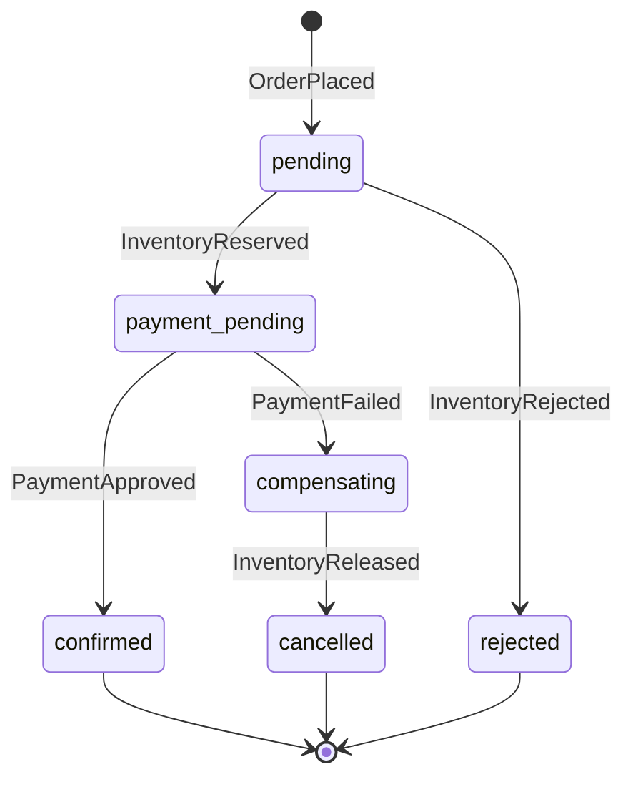

# Business rules and critical flows

This document is the source of truth for how FORMA behaves. Every rule has acceptance criteria that a tester can check. Storefront features are numbered **SF-xx**, critical business flows **CF-xx**. When the code and this document disagree, that is a defect in one of them.

## Product and customer model

FORMA sells a seeded catalog of **89 fictional products in 9 categories and 24 subcategories**. A visitor can browse, search, filter and read help pages without signing in. Customers must register or sign in before modifying a cart or wishlist, placing an order, or viewing orders and payments. Every registered user has the customer role. There is no operational administrator role; the local QA laboratory is a separate, intentionally open control surface reached from the footer.

Every product has:

| Field | Meaning |
|---|---|
| `category` / `subcategory` | Top-level category and its subcategory. Every product belongs to exactly one subcategory. |
| `price` | Price charged at checkout, in USD cents. For a Black Friday product this is already the reduced price. |
| `compareAtPrice` | Original price before the Black Friday reduction, or `null` when the product is not on a deal. |
| `deal` | `black-friday` or `null`. A product is on a deal exactly when `compareAtPrice` is set. |
| `freeShipping` | `true` when the product ships free on its own (see CF-12). |
| `popularity` | Score 0–100 used for "Most popular" sorting. Higher is more popular. |
| `stock` | Initial seed stock only. `GET /inventory` is the source of current availability. |

Cart contents are saved on the server per customer. A customer can have at most 20 distinct products with integer quantities of 1–10. Adding an item to the cart does **not** reserve stock. Inventory is reserved only after an order has been accepted.

### Categories

Categories have two levels. Names are exact and case-sensitive in the API.

| Category | Subcategories |
|---|---|
| Electronics | Audio, Gaming, Phones & Tablets, Smart Home, Computer Accessories |
| Home & Living | Kitchen, Lighting, Decor, Textiles |
| Office & School | Workspace, Stationery |
| Sports & Outdoors | Fitness, Outdoor & Camping, Cycling |
| Travel & Bags | Bags & Backpacks, Travel Accessories |
| Garden | Plants & Seeds, Garden Tools |
| Kids & Toys | Toys & Games, Learning |
| Beauty & Health | Personal Care, Wellness |
| Pets | Dogs, Cats |

Five subcategories are marked **popular** and appear directly in the navigation row: Audio, Gaming, Smart Home, Fitness and Phones & Tablets. A subcategory name is unique across the whole tree.

## Money, discounts and shipping

All prices and calculations use integer **USD cents**. There is no tax calculation or currency conversion.

```text
subtotal         = sum(unit price × quantity)              unit price already includes Black Friday
couponDiscount   = round(subtotal × 0.10) for SAVE10, otherwise 0
paymentDiscount  = round((subtotal − couponDiscount) × 0.10) when paid with a Mastercard, otherwise 0
discount         = couponDiscount + paymentDiscount
shipping         = 0 if subtotal − discount >= 15000
                   0 if every line in the cart has freeShipping = true
                   700 otherwise
total            = subtotal − discount + shipping
```

Rules in plain words:

1. **Black Friday first.** The deal price is the product price; there is no separate Black Friday line on the receipt.
2. **Coupon second.** SAVE10 takes 10% off the subtotal.
3. **Mastercard third.** Paying with a Mastercard (saved or new) takes 10% off what is left after the coupon. All three discounts combine.
4. **Shipping last.** The $150 free-shipping boundary is inclusive and is evaluated **after all discounts**. Independently of the amount, a cart in which **every** product has free shipping ships free. One product without free shipping makes the cart pay $7.00 unless the $150 rule applies.
5. Each discount is rounded to the nearest cent separately, half up (`Math.round`). Three products have prices with cents (Pocket Notebook 3-pack $19.95, Twist Phone Grip $12.95, Glow Night Light $24.95) so that 10% ends in half a cent and the rounding rule can be tested.

| Basket | Coupon | Payment | Subtotal | Coupon | Mastercard | Shipping | Total |
|---|---|---|---:|---:|---:|---:|---:|
| 1 × Arc Headphones | – | Visa | $129.00 | $0.00 | $0.00 | $7.00 | $136.00 |
| 1 × Arc Headphones | SAVE10 | Visa | $129.00 | $12.90 | $0.00 | $7.00 | $123.10 |
| 1 × Arc Headphones | – | Mastercard | $129.00 | $0.00 | $12.90 | $7.00 | $123.10 |
| 1 × Arc Headphones | SAVE10 | Mastercard | $129.00 | $12.90 | $11.61 | $7.00 | $111.49 |
| 2 × Orbit Lamp | – | Visa | $158.00 | $0.00 | $0.00 | $0.00 | $158.00 |
| 2 × Orbit Lamp | SAVE10 | Visa | $158.00 | $15.80 | $0.00 | $7.00 | $149.20 |
| 2 × Orbit Lamp | SAVE10 | Mastercard | $158.00 | $15.80 | $14.22 | $7.00 | $134.98 |
| 1 × Note Dotted Journal (free shipping) | – | Visa | $18.00 | $0.00 | $0.00 | $0.00 | $18.00 |
| 1 × Note Dotted Journal + 1 × Still Mug | – | Visa | $42.00 | $0.00 | $0.00 | $7.00 | $49.00 |
| 2 × Shell Phone Case + 1 × Flow Yoga Mat (all free shipping) | – | Visa | $77.00 | $0.00 | $0.00 | $0.00 | $77.00 |
| 1 × Nova Gaming Chair (Black Friday, was $349.00) | – | Visa | $249.00 | $0.00 | $0.00 | $0.00 | $249.00 |
| 1 × Pocket Notebook 3-pack ($19.95) | SAVE10 | Visa | $19.95 | $2.00 (1.995 rounds up) | $0.00 | $7.00 | $24.95 |
| 1 × Pocket Notebook 3-pack | SAVE10 | Mastercard | $19.95 | $2.00 | $1.80 (1.795 rounds up) | $7.00 | $23.15 |
| 1 × Twist Phone Grip ($12.95) | SAVE10 | Mastercard | $12.95 | $1.30 | $1.17 (1.165 rounds up) | $7.00 | $17.48 |

`SAVE10` is valid without a minimum. `EXPIRED` always fails validation. Other nonempty coupon codes fail validation. The frontend trims and uppercases coupon input; the API expects the exact uppercase codes. Every amount is authoritative on the backend; the frontend calculation is only a preview, and a mismatch is rejected with 409 (CF-07).

The order stores `subtotal`, `couponDiscount`, `paymentDiscount`, `discount` (the sum of both), `shipping` and `total`, so every receipt line can be verified after the fact. Each order line stores `unitPrice` and `freeShipping` as they were at checkout.

## Order state machine



`pending`, `payment_pending` and `compensating` are intermediate states. `confirmed`, `rejected` and `cancelled` are terminal. A new order returns HTTP 202, which means accepted for processing rather than successfully paid. Clients must poll the order for a terminal result. Stock is deducted at reservation, so an order waiting for payment holds its units.

## CF-01: Register, sign in and expire a session

1. Register with a name, a syntactically valid unique email and a password of 8–128 characters. Email comparison is case-insensitive after trimming. Registration is reachable from the header (Create account), the footer, the sign-in dialog and every sign-in prompt. The browser also asks for the password twice and checks that both match; the confirmation is never sent to the API.

   Registration form messages: "Enter your name", "Enter a valid email address, for example name@example.com", "Enter a password", "Use at least 8 characters", "Use at most 128 characters", "The passwords do not match". A duplicate email (409) marks the email field "This email is already registered" and suggests signing in. Success signs the customer in immediately and shows "Account created".
2. Receive an opaque bearer token and an absolute expiration timestamp. Passwords are salted and scrypt-hashed.
3. Use the token for cart, order and payment requests.
4. Log out to revoke that token, or let its expiration time pass.

Acceptance: invalid credentials return 401; duplicate email returns 409; invalid registration returns 422; an expired token returns 401. Changing the scenario lifetime affects **new** sessions, not already issued tokens. Browser tokens are held in sessionStorage and removed on an API 401. Other sessions for the same account remain independent.

## CF-02: Browse and prepare a cart

1. Browse by category, deal, free shipping or search using the debounced input (see SF-02 to SF-05).
2. Select a product using its card context; multiple buttons share the same visible name.
3. Add products and adjust quantities in the bag. Zero removes a line from the frontend; the API expects omitted lines rather than quantity zero.
4. The server validates product existence, uniqueness and quantity range. Stock is not checked until reservation.

Acceptance: search, category, deal, free-shipping and sort changes reset pagination to page 1. Replacing a cart persists it across sign-out and sign-in. Invalid carts do not replace a valid saved cart. Customers have separate carts. A sold-out button is disabled when the collection was rendered, but the backend still handles a stale or API-created cart.

## CF-03: Successful checkout

Preconditions: signed-in customer, nonempty cart, baseline scenario, sufficient stock.

1. Submit fictional shipping details, a payment method (`card` with a saved or new card, or `test-wallet`, see CF-14 and CF-15), optional coupon and the client-calculated expected total. The client supplies an idempotency key.
2. Orders rechecks authoritative catalog prices, address, coupon, method and expected total. If the saved cart changed while catalog lookups ran, checkout returns 409.
3. In one local transaction, save the order as `pending`, record the idempotency key, clear the cart and append `OrderPlaced` to the outbox.
4. Inventory reserves all lines atomically and emits `InventoryReserved`.
5. Payments records one approval for the order and emits `PaymentApproved`.
6. Orders becomes `confirmed` and emits `OrderConfirmed`.

Acceptance: money matches the formula; stock decreases by exactly the ordered quantity; a single payment record exists; the history is `pending → payment_pending → confirmed`; clearing the cart does not depend on eventual success. Confirmation means simulated purchase completion, not shipment.

## CF-04: Competing for the last item

Preconditions: fresh data, Pocket Mini Speaker has one unit, two independent customers.

Both customers can put the speaker in their cart and both can receive an accepted order. Inventory serializes reservations in its database transaction. Exactly one reservation succeeds; the other order becomes `rejected`. The losing order has no payment record; its payment lookup remains `pending` because no payment was attempted (consult the order state for the authoritative outcome).

Acceptance: one confirmed order, one rejected order and available stock zero. No negative stock, partial multi-line reservation or charge for the rejected order. A stock-rejected order's cart has already been cleared; the customer must rebuild it to try again.

## CF-05: Declined or timeout payment and compensation

Enable `paymentMode=decline` or `timeout` before payment processing. Inventory first reserves the items. Payments records failure and emits `PaymentFailed`. Orders moves to `compensating`. Inventory returns the reserved units once and emits `InventoryReleased`; Orders then becomes `cancelled`.

Acceptance: history is `pending → payment_pending → compensating → cancelled`; stock equals its original value, adjusted for unrelated orders; one failed payment exists; retrying or redelivering the same event does not release stock twice. `timeout` is a simulated definitive failure, so release is safe within this model; real payment ambiguity and reconciliation are outside scope. The cart remains empty after cancellation.

A declined card follows exactly the same path with reason `card_declined` (CF-15).

## CF-06: Retry checkout safely

Repeat the exact checkout JSON with the same idempotency key and account. The service returns the original order with HTTP 200, even if the cart is now empty or the order is terminal. Reusing that key with a different JSON serialization returns 409. The fingerprint is a SHA-256 hash of the exact `JSON.stringify` serialization of the parsed request, so card numbers are never stored in it; property ordering still matters. A different customer has a separate key namespace.

Acceptance: retry causes no second order, stock deduction or payment. A new key with an empty cart returns 422. Keep the original request and key when retrying a transport failure. The UI retains a key within a checkout attempt; after closing/reopening or editing details, review request semantics. Changing the coupon rotates its key. A fresh purchase after acceptance needs a rebuilt cart and a new key.

## CF-07: Stale price, validation and shipping boundaries

Enable stale storefront prices. Product-list responses show a price $1 below the authoritative product detail price. Checkout rejects a mismatching expected total with 409 **before** saving an order or clearing the cart. Restore baseline and reload the collection to recover.

Acceptance: no payment or reservation on validation failure. Address needs nonblank name, line1, city, postalCode and country (max 200 characters each); country/postal format is not geographically validated. All payments are simulated. Card details are validated (CF-15), but only the ten published test numbers are approved; no real card is ever charged. Only a Mastercard changes the price (CF-13).

## CF-08: Consumer outage and recovery

Pause inventory before checkout: new orders remain `pending` and stock is unchanged. Pause payments: inventory reserves stock, and orders remain `payment_pending`. Resume the consumer to drain its backlog. In local transport mode the outbox, inbox and cursor survive service restarts. Settings are evaluated when processing each event; changing payment outcome while paused affects queued payments when they resume.

Acceptance: no new order is needed to recover; eventual state and stock match the chosen outcome. There is no reservation expiry or automatic timeout for paused consumers. Restarting a process is different from resetting data. Never restore a single service's old database into a newer multi-service timeline.

## CF-09: Ownership and session failure during checkout

Customer B requesting Customer A's order or payment receives 404 to avoid disclosing ownership. Expired sessions reject protected actions. The browser clears its token when it sees 401; the server cart remains saved. If an order was accepted before the session expired, processing continues without the browser, and the customer can sign in again to inspect it.

## CF-10: Wishlist

A signed-in customer can save products to a wishlist to find them again later.

1. Every product card shows a heart button. An empty heart (♡) means not saved, a filled heart (♥) means saved. The button exposes the state with `aria-pressed` and an accessible name of "Add <product> to wishlist" or "Remove <product> from wishlist".
2. Clicking the heart while signed out opens the sign-in dialog and changes nothing.
3. Clicking the heart while signed in adds or removes the product. Every card for that product on the page updates, the header wishlist counter updates, and a toast confirms the action.
4. The wishlist page (`#wishlist`) lists saved products newest first with live price and stock. From there the customer can add a product to the bag or remove it from the wishlist.

Rules:

- The wishlist belongs to the account and is stored on the server. It survives sign-out, sign-in from another browser and restarts.
- Maximum **50** products. Adding a 51st returns 422 `Wishlist can hold at most 50 products`.
- Adding a product that is already saved changes nothing and returns 200 with the unchanged list (idempotent). Its original `addedAt` is kept.
- Removing a product that is not saved returns 200 with the unchanged list (idempotent).
- Adding an unknown product returns 404 `Product not found`.
- Saving a product does not reserve stock and does not add it to the bag. Sold-out products can still be saved.
- Each customer sees only their own wishlist. There is no endpoint to read another customer's wishlist.

Acceptance: header count equals the number of saved products; the same product never appears twice; signed-out heart clicks never call the wishlist API; the list order is newest first; the 50-product limit holds.

## CF-11: Black Friday deals

Selected products are reduced for Black Friday. The catalog seeds 21 deal products with reductions between 20% and 40%.

- A deal product has `deal = "black-friday"` and a `compareAtPrice` higher than `price`.
- The card shows a red badge "Black Friday −N%", the reduced price in red and the original price struck through. `N = round((1 − price / compareAtPrice) × 100)`.
- The reduced `price` is the authoritative price for the cart, checkout and the order. The original price is informational only and never charged.
- Black Friday combines with SAVE10, Mastercard and free shipping.
- "Black Friday" in the navigation opens `#shop?deal=black-friday`, which lists only deal products.

Acceptance: every product returned for `deal=black-friday` has a `compareAtPrice` above its `price`; no product outside the deal has a `compareAtPrice`; the order line `unitPrice` equals the reduced price; badges show the rounded percentage.

## CF-12: Free shipping products

Some products ship free on their own (`freeShipping = true`). The catalog seeds 29 of them.

- The card shows "✓ Free shipping".
- A cart ships free when **every** line is a free-shipping product, regardless of the amount.
- A cart that mixes free-shipping and other products pays the normal $7.00, unless its amount after discounts reaches $150 (the general rule).
- An empty cart has no shipping rule applied; checkout of an empty cart is rejected with 422.
- "Free shipping" in the navigation opens `#shop?freeShipping=true`, which lists only free-shipping products.

Acceptance: see the free-shipping rows of the pricing table. Removing the last non-free product from a mixed cart makes shipping $0.00; adding one non-free product brings it back.

## CF-13: Mastercard discount

Paying with a **Mastercard** takes 10% off the order. It does not matter whether the card is saved or entered as a new card; the brand decides.

- The discount is applied after the coupon and before the shipping rule (see the formula).
- It combines with SAVE10 and with Black Friday prices.
- Because it is applied before shipping, it can push an order below $150 and bring the $7.00 shipping back.
- Checkout shows the coupon and Mastercard discounts on separate lines, then the total discount. Choosing a Mastercard, or typing a number that starts like a Mastercard, updates the preview immediately. Saved Mastercards are marked "−10%".
- A Mastercard payment can still be declined (CF-15). The discount is then irrelevant because nothing is charged.
- The order records `paymentDiscount`.

Acceptance: totals match the table for every coupon and brand combination; a client that omits the Mastercard discount from `expectedTotal` gets 409 with the correct total.

## CF-14: Saved cards

A signed-in customer can keep cards in the account and pay with them in one click.

- A saved card stores **only** brand, last four digits, expiry month and year, cardholder name and an id. The full number and the security code are never stored, logged or returned.
- At most **5** saved cards per customer. Saving a sixth returns 422 `You can save at most 5 cards`.
- A card is saved either at checkout with "Save this card for next time" (default on) or through `POST /cards`. At checkout the card is saved when the order is **accepted**, even if the payment is later declined.
- Saving a card whose brand, last four digits and expiry match an existing saved card does not create a duplicate; the existing card is used.
- Expired saved cards are listed with "Expired" and cannot be selected. Paying with one through the API returns 422 `This saved card has expired. Choose another card`.
- The customer can remove a saved card at checkout. Removing an unknown card returns 404 `Card not found`.
- Customers see only their own cards. Another customer's card id at checkout returns 422 `Saved card not found`.
- The demo account starts with four saved cards so every outcome can be tried immediately:

| Saved card | Expiry | Result |
|---|---|---|
| Visa •••• 4242 | 12/30 | Approved |
| Mastercard •••• 4444 | 08/29 | Approved, 10% off |
| Visa •••• 0002 | 05/29 | Declined |
| Mastercard •••• 5100 | 01/25 | Expired, cannot be selected |

## CF-15: Card payments, validation and test cards

Payment methods are `card` and `test-wallet`. With `card` the request contains **exactly one** of `savedCardId` or `card` (a new card). Sending both or neither returns 422.

**Validation** (frontend and backend use the same rules; the backend is authoritative and returns 422 with the failing `field`):

| Field | Rule | Message |
|---|---|---|
| `holder` | 2–100 characters; starts with a letter; letters, spaces, `.`, `'`, `-` | Enter the cardholder name as it appears on the card |
| `number` | 13–19 digits after removing spaces and dashes; passes the Luhn check | Enter a valid card number |
| `number` | Visa (16 digits, starts with 4), Mastercard (16 digits, 51–55 or 2221–2720), American Express (15 digits, 34 or 37) | We accept Visa, Mastercard and American Express |
| `expiry` | Format `MM/YY` | Enter the expiry date as MM/YY |
| `expiry` | Month 01–12 | Expiry month must be between 01 and 12 |
| `expiry` | Valid through the last day of its month; earlier is expired | This card has expired |
| `expiry` | At most 20 years ahead | Expiry date is too far in the future |
| `cvc` | Exactly 3 digits, or 4 for American Express | Enter the 3-digit (or 4-digit) security code |

The checkout page formats the number in groups while typing (4-4-4-4, or 4-6-5 for American Express), inserts the slash in the expiry date, shows the detected brand next to the number, validates each field when it loses focus, and validates all fields again on submit. Invalid fields are marked with `aria-invalid` and a message linked through `aria-describedby`.

**Outcome.** A card that passes validation is accepted at checkout (HTTP 202). The payment is decided later by the simulated processor:

| Card | Result |
|---|---|
| One of the 10 approved test numbers below | Payment approved, order confirmed |
| Any other valid number | Payment declined: `PaymentFailed` with reason `card_declined`, stock released, order cancelled (CF-05 path) |

Approved test numbers: Visa `4242 4242 4242 4242`, `4111 1111 1111 1111`, `4012 8888 8888 1881`, `4000 0566 5566 5556`; Mastercard `5555 5555 5555 4444`, `5105 1051 0510 5100`, `2223 0031 2200 3222`, `5200 8282 8282 8210`; American Express `3782 822463 10005`, `3714 496353 98431`. A good number to see a decline is `4000 0000 0000 0002`.

The QA laboratory payment outcome wins over the card: with `paymentMode` set to `decline` or `timeout`, even an approved test card fails with that reason. `test-wallet` is always approved in baseline.

Acceptance: a declined card is never charged (payment `failed`), stock returns to its previous value, the order history ends `compensating → cancelled` with reason `card_declined`, and the customer is told (SF-09).

## SF-01: Header

From left to right on desktop:

1. **Brand** "forma®" in the top-left corner, linking to the home page (`#home`).
2. **Search** directly to the right of the brand, half of the header width (see SF-05).
3. Empty space.
4. **Wishlist** link with a counter of saved products. Signed out, it opens the sign-in dialog.
5. **Account**. Signed out it shows **Sign in** (opens the sign-in dialog) and a **Create account** button (opens the registration dialog). Signed in, Create account disappears. Signed in it shows the customer name and opens a menu with My orders, Wishlist and Sign out. The menu closes on Escape, on an outside click and after choosing an item.
6. **Bag** with the total item quantity. Signed out it opens the sign-in dialog.

Below 850 px wide, search moves to its own full-width row under the brand and actions.

## SF-02: Navigation row and categories

Under the header, one row:

1. **All categories** mega menu in the left corner. The left column lists the 9 categories with product counts; pointing at or focusing a category shows its subcategories on the right, with "Shop all <category>". The last entry, "All categories →", opens the categories page (SF-10). Keyboard: Enter/Space opens, Arrow Up/Down moves between categories, Arrow Right moves into the subcategories, Arrow Left goes back, Escape closes and returns focus to the toggle.
2. **Black Friday** link (CF-11), shown in red.
3. **Free shipping** link (CF-12).
4. **Popular subcategories**: one-click links to the five subcategories marked popular.

The link matching the current listing is highlighted. On small screens the row scrolls horizontally.

## SF-03: Promotion bar

A full-width green bar under the navigation rotates promotional messages: the Mastercard discount, Black Friday (with a link), the free-shipping rules and SAVE10.

- A new message appears every 5 seconds.
- Rotation pauses while the pointer is over the bar or focus is inside it, and stops completely with the Pause button (which then reads Play). This satisfies WCAG 2.2.2 Pause, Stop, Hide.
- Previous and next arrows change the message manually at any time.
- The position is shown as "n/4". Messages are not announced to screen readers automatically.

The bar only advertises. Every promise in it must match a rule in this document.

## SF-04: Home page shelves (carousels)

The home page shows four shelves, each a row of products with left and right arrows:

| Shelf | Content |
|---|---|
| Black Friday deals | Deal products, most popular first |
| Most popular | All products by popularity |
| Free shipping picks | Free-shipping products, most popular first |
| Better desk days | Office & School › Workspace |

Rules:

- Each shelf loads up to 12 products and shows **4 at a time** on wide screens (3 below 1100 px, 2 below 800 px, 1 below 520 px).
- The right arrow shows the next group, the left arrow the previous group. An arrow is disabled at the start or end of the shelf. The visible range is exposed as `data-position`, for example `5-8 of 12`.
- "See all →" opens the same filter as a full listing.
- A shelf that fails to load shows its own error and does not break the other shelves.

## SF-05: Search and product listing

- Typing in the header search waits 350 ms, then opens `#shop?q=<text>`. Enter or the Search button opens it immediately.
- Search matches the product name, category or subcategory, case-insensitively, ignoring leading and trailing spaces. "gaming" finds all Gaming products.
- The listing (`#shop`) combines search, category, subcategory, Black Friday and free-shipping filters. A breadcrumb shows Home › All categories › Category › Subcategory. When a category is selected, chips for its subcategories (with counts) narrow the list; removing the category filter also removes the subcategory. Active filters appear as chips; removing a chip keeps the other filters. "Clear all" removes all filters.
- Sorting: Featured (catalog order), Most popular, Price low to high, Price high to low.
- 8 products per page with Previous and Next. Any filter or sort change returns to page 1.
- Every listing state is part of the URL, so it can be bookmarked, shared and opened directly.
- No results shows an empty state with a hint.

## SF-06: Shopping help pages

The footer section **Shopping** links to six pages, each at its own address:

| Page | Address | Content |
|---|---|---|
| Platform notices | `#help/notices` | Current announcements: Black Friday, wishlist, Mastercard, practice-store notice |
| Delivery and payment methods | `#help/delivery-and-payment` | Shipping table, payment methods, when an order counts as paid |
| Complaints and returns | `#help/returns` | Steps to request a return and the return rules |
| Frequently asked questions | `#help/faq` | Expandable questions and answers |
| Test cards | `#help/test-cards` | The 10 approved test cards, the decline example and the validation rules |
| How to shop online | `#help/how-to-shop` | Five illustrated steps from search to order tracking, with screenshots |

A side menu links all help pages and marks the current one. An unknown help address opens the FAQ. Help content describes behavior; where it states a rule, the rule in this document wins.

Return rules published to customers: returns within 14 days of confirmation, only for confirmed orders, shipping refunded only when the whole order is returned, handled by support (there is no return feature in the system).

## SF-07: Footer and the QA laboratory

The footer contains the brand, the Shopping help links, account links (My orders, Wishlist, Create an account) and deal links. The **QA laboratory** and the **API specification** are deliberately placed in small print at the very bottom of the footer. The laboratory (`#lab`) works exactly as before: global scenario controls, service health and the event stream. It is not part of the customer navigation.

## SF-08: Checkout page

Checkout is a page (`#checkout`), not a dialog. "Continue to checkout" in the bag opens it.

- Signed out: a sign-in prompt. Empty bag: an empty state with "Continue shopping".
- Left column: **1. Delivery address** (recipient, street, city, postal code, country), **2. Payment** (saved cards, add a new card, test wallet), **3. Discount code**. Right column: order summary with products, live totals and "Place order".
- The first saved card that is not expired is selected by default; without one, "Add a new card" is selected.
- The discount code field reports immediately: "✓ SAVE10 applied", "✗ This code has expired" or "✗ We do not recognise this code". The backend still rejects EXPIRED and unknown codes with 422.
- Address fields are required (max 200 characters) and validated on blur and on submit.
- Place order is disabled while the request runs and reads "Placing order…".
- Success (202): the bag is emptied, the customer sees "Order placed" and lands on the order page (SF-09).
- Failure (409 or 422): the order is not placed, the customer stays on the page with everything filled in, the message appears above the button and as a notification, and the field named by the backend is highlighted.
- Changing the coupon or the payment selection starts a new idempotency key; resubmitting after a validation error keeps the key.

## SF-09: Notifications and the order page

**Notifications** appear in the top-right corner (bottom on phones) for every action that changes something or fails. Each has a type (success, error, warning, info), a title, a message and a close button. Success and info disappear after 5 seconds, errors after 9; at most 4 are shown. Errors use `role="alert"`, others `role="status"`.

| Situation | Type | Title / message |
|---|---|---|
| Sign in / register | success | Welcome back / Account created |
| Sign out | info | You have been signed out |
| Session expired (any 401 while signed in) | warning | Signed out: your session has expired |
| Add to bag / remove last unit | success / info | Added to your bag / removed from your bag |
| Bag or wishlist action while signed out | info | Sign in to … |
| Wishlist add / remove | success / info | Saved to / removed from your wishlist |
| Checkout with invalid fields | error | Order not placed: please fix the highlighted fields |
| Order rejected by the API (409, 422) | error | Order was not placed: <reason> |
| Order accepted (202) | success | Order placed: we are processing your payment |
| Payment approved | success | Payment successful: order confirmed |
| Payment failed | error | Payment failed: <reason>, order cancelled, not charged |
| Stock lost to another customer | error | Order not completed: out of stock, not charged |
| Saved card removed | info | Card removed |
| Browser offline / online again | warning / success | No connection / The connection is back |

Payment results are announced **wherever the customer is** in the app: accepted orders are watched every 2 seconds until they reach a terminal state, and the watch list survives a page reload in the same tab.

**Order page** (`#order/<id>`): a status banner that updates by itself (Order received → Processing your payment → Payment successful, or Payment failed / Order not completed), a timeline of every status with times, the products, the totals with each discount, the payment ("Mastercard •••• 4444"), the delivery address and the time placed. After a failed or rejected order, "Put these products back in my bag" restores the bag and opens checkout. Another customer's order id shows an error (404 from the API).

## SF-10: All categories page

`#categories` shows every category as a card: an icon (the category's most popular product), the name, the product count, each subcategory with its count, and "Shop all <category> →". Every name is a link to the filtered listing. The page is reachable from the mega menu, the footer and the breadcrumb.

## Data lifecycle and scope

Business data and settings persist across process restarts. Baseline restores scenario defaults only. Full reset creates a new lab timeline and reseeds initial stock. There is no customer order cancellation endpoint, self-service return or refund flow, inventory restock endpoint, real shipment, tax, currency exchange or real financial transaction. Returns described on the help pages are handled by support outside the system. Those can be added as new independent challenges without changing the documented baseline contract.

**Catalog upgrades.** The catalog is reference data with a version number. When a newer seed version starts against existing data, the catalog service replaces its product list, and inventory adds stock **only for products it has never seen**. Existing stock counts, users, carts, wishlists and orders stay as they were. A full reset is still the way to get fresh stock for every product.
