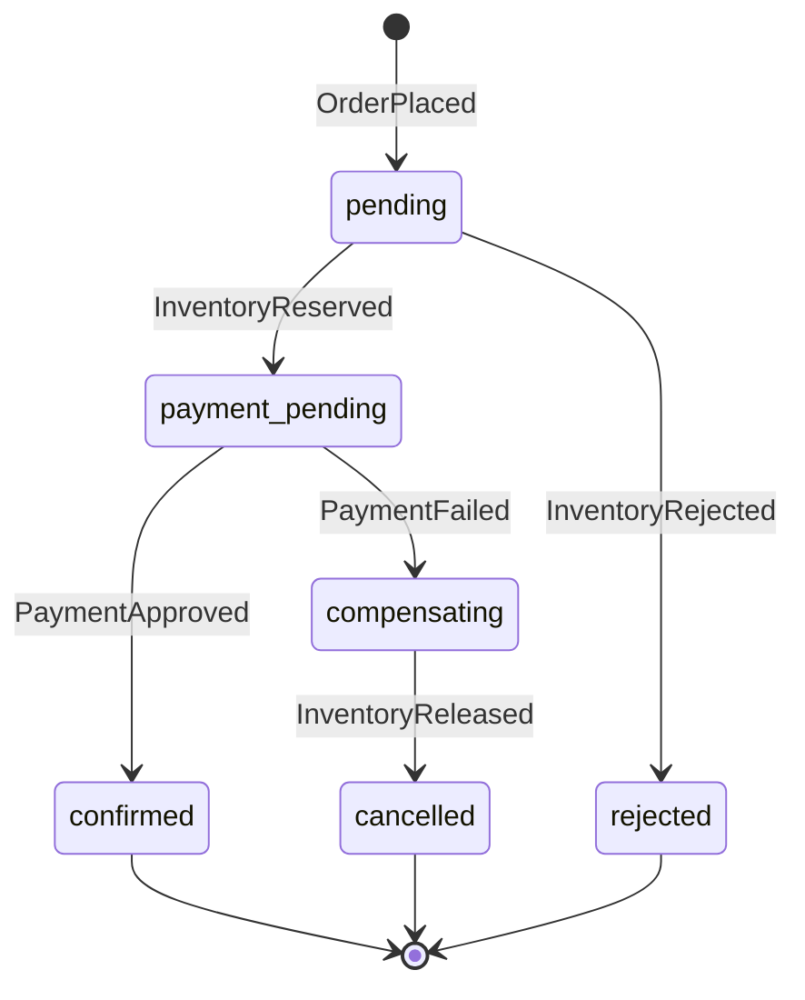

# Business rules and critical flows

## Product and customer model

FORMA sells a seeded collection of nine fictional everyday objects. A visitor can browse without signing in. Customers must register or sign in before modifying a cart, placing an order, or viewing orders and payments. Every registered user has the customer role. There is no operational administrator role; the local QA laboratory is a separate intentionally open control surface.

Cart contents are saved on the server per customer. A customer can have at most 20 distinct products with integer quantities of 1–10. Adding an item to the cart does **not** reserve stock. Inventory is reserved only after an order has been accepted. Stock shown in a product response is the original seed amount; `/inventory` is the source of current availability.

## Money and discounts

All prices and calculations use integer **USD cents**. There is no tax calculation or currency conversion.

```text
subtotal = sum(unit price × quantity)
discount = round(subtotal × 0.10) for SAVE10, otherwise 0
shipping = 0 if subtotal − discount >= 15000, otherwise 700
total = subtotal − discount + shipping
```

The free-shipping boundary is inclusive and evaluated **after** discount. For example:

| Basket | Subtotal | Discount | Shipping | Total |
|---|---:|---:|---:|---:|
| 1 × Arc Headphones | $129.00 | $0.00 | $7.00 | $136.00 |
| 1 × Arc Headphones + SAVE10 | $129.00 | $12.90 | $7.00 | $123.10 |
| 2 × Orbit Lamp | $158.00 | $0.00 | $0.00 | $158.00 |
| 2 × Orbit Lamp + SAVE10 | $158.00 | $15.80 | $7.00 | $149.20 |

`SAVE10` is valid without a minimum. `EXPIRED` always fails validation. Other nonempty coupon codes fail validation. The frontend trims and uppercases coupon input; the API expects the exact uppercase codes. Discount, shipping and total are authoritative on the backend.

## Order state machine



`pending`, `payment_pending` and `compensating` are intermediate states. `confirmed`, `rejected` and `cancelled` are terminal. A new order returns HTTP 202, which means accepted for processing rather than successfully paid. Clients must poll the order for a terminal result. Stock is deducted at reservation, so an order waiting for payment holds its units.

## CF-01: Register, sign in and expire a session

1. Register with a name, a syntactically valid unique email and a password of 8–128 characters. Email comparison is case-insensitive after trimming.
2. Receive an opaque bearer token and an absolute expiration timestamp. Passwords are salted and scrypt-hashed.
3. Use the token for cart, order and payment requests.
4. Log out to revoke that token, or let its expiration time pass.

Acceptance: invalid credentials return 401; duplicate email returns 409; invalid registration returns 422; an expired token returns 401. Changing the scenario lifetime affects **new** sessions, not already issued tokens. Browser tokens are held in sessionStorage and removed on an API 401. Other sessions for the same account remain independent.

## CF-02: Browse and prepare a cart

1. Browse by category or search using the debounced input.
2. Select a product using its card context; multiple buttons share the same visible name.
3. Add products and adjust quantities in the bag. Zero removes a line from the frontend; the API expects omitted lines rather than quantity zero.
4. The server validates product existence, uniqueness and quantity range. Stock is not checked until reservation.

Acceptance: search/category/sort changes reset pagination. Replacing a cart persists it across sign-out and sign-in. Invalid carts do not replace a valid saved cart. Customers have separate carts. A sold-out button is disabled when the collection was rendered, but the backend still handles a stale or API-created cart.

## CF-03: Successful checkout

Preconditions: signed-in customer, nonempty cart, baseline scenario, sufficient stock.

1. Submit fictional shipping details, a simulated payment method, optional coupon and the client-calculated expected total. The client supplies an idempotency key.
2. Orders rechecks authoritative catalog prices, address, coupon, method and expected total. If the saved cart changed while catalog lookups ran, checkout returns 409.
3. In one local transaction, save the order as `pending`, record the idempotency key, clear the cart and append `OrderPlaced` to the outbox.
4. Inventory reserves all lines atomically and emits `InventoryReserved`.
5. Payments records one approval for the order and emits `PaymentApproved`.
6. Orders becomes `confirmed` and emits `OrderConfirmed`.

Acceptance: money matches the formula; stock decreases by exactly the ordered quantity; a single payment record exists; the history is `pending → payment_pending → confirmed`; clearing the cart does not depend on eventual success. Confirmation means simulated purchase completion, not shipment.

## CF-04: Competing for the last item

Preconditions: fresh data, Pocket Mini Speaker has one unit, two independent customers.

Both customers can put the speaker in their cart and both can receive an accepted order. Inventory serializes reservations in its database transaction. Exactly one reservation succeeds; the other order becomes `rejected`. The losing order has no payment record; its payment lookup remains `pending` because no payment was attempted (consult the order state for the authoritative outcome).

Acceptance: one confirmed order, one rejected order and available stock zero. No negative stock, partial multi-line reservation or charge for the rejected order. A stock-rejected order's cart has already been cleared; the customer must rebuild it to try again.

## CF-05: Declined or timeout payment and compensation

Enable `paymentMode=decline` or `timeout` before payment processing. Inventory first reserves the items. Payments records failure and emits `PaymentFailed`. Orders moves to `compensating`. Inventory returns the reserved units once and emits `InventoryReleased`; Orders then becomes `cancelled`.

Acceptance: history is `pending → payment_pending → compensating → cancelled`; stock equals its original value, adjusted for unrelated orders; one failed payment exists; retrying or redelivering the same event does not release stock twice. `timeout` is a simulated definitive failure, so release is safe within this model; real payment ambiguity and reconciliation are outside scope. The cart remains empty after cancellation.

## CF-06: Retry checkout safely

Repeat the exact checkout JSON with the same idempotency key and account. The service returns the original order with HTTP 200, even if the cart is now empty or the order is terminal. Reusing that key with a different JSON serialization returns 409. The fingerprint is the exact `JSON.stringify` serialization of the parsed request; property ordering therefore matters. A different customer has a separate key namespace.

Acceptance: retry causes no second order, stock deduction or payment. A new key with an empty cart returns 422. Keep the original request and key when retrying a transport failure. The UI retains a key within a checkout attempt; after closing/reopening or editing details, review request semantics. Changing the coupon rotates its key. A fresh purchase after acceptance needs a rebuilt cart and a new key.

## CF-07: Stale price, validation and shipping boundaries

Enable stale storefront prices. Product-list responses show a price $1 below the authoritative product detail price. Checkout rejects a mismatching expected total with 409 **before** saving an order or clearing the cart. Restore baseline and reload the collection to recover.

Acceptance: no payment or reservation on validation failure. Address needs nonblank name, line1, city, postalCode and country (max 200 characters each); country/postal format is not geographically validated. Both `test-card` and `test-wallet` are simulated and follow the configured global payment outcome. No real card data is requested or accepted as a payment method.

## CF-08: Consumer outage and recovery

Pause inventory before checkout: new orders remain `pending` and stock is unchanged. Pause payments: inventory reserves stock, and orders remain `payment_pending`. Resume the consumer to drain its backlog. In local transport mode the outbox, inbox and cursor survive service restarts. Settings are evaluated when processing each event; changing payment outcome while paused affects queued payments when they resume.

Acceptance: no new order is needed to recover; eventual state and stock match the chosen outcome. There is no reservation expiry or automatic timeout for paused consumers. Restarting a process is different from resetting data. Never restore a single service's old database into a newer multi-service timeline.

## CF-09: Ownership and session failure during checkout

Customer B requesting Customer A's order or payment receives 404 to avoid disclosing ownership. Expired sessions reject protected actions. The browser clears its token when it sees 401; the server cart remains saved. If an order was accepted before the session expired, processing continues without the browser, and the customer can sign in again to inspect it.

## Data lifecycle and scope

Business data and settings persist across process restarts. Baseline restores scenario defaults only. Full reset creates a new lab timeline and reseeds initial stock. There is no customer order cancellation endpoint, refund flow, inventory restock endpoint, real shipment, tax, currency exchange or real financial transaction. Those can be added as new independent challenges without changing the documented baseline contract.
